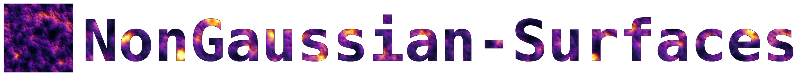
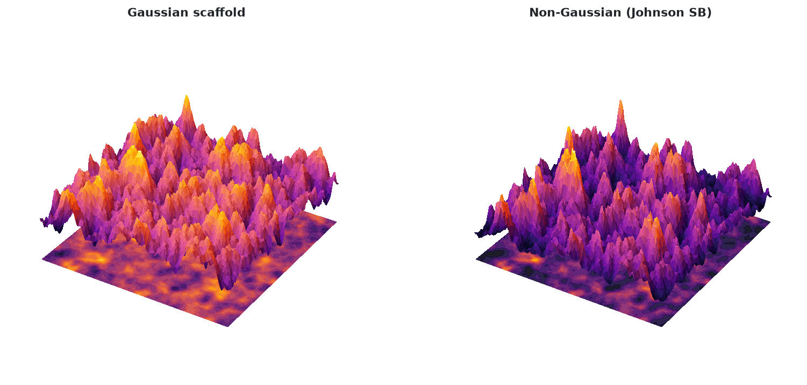
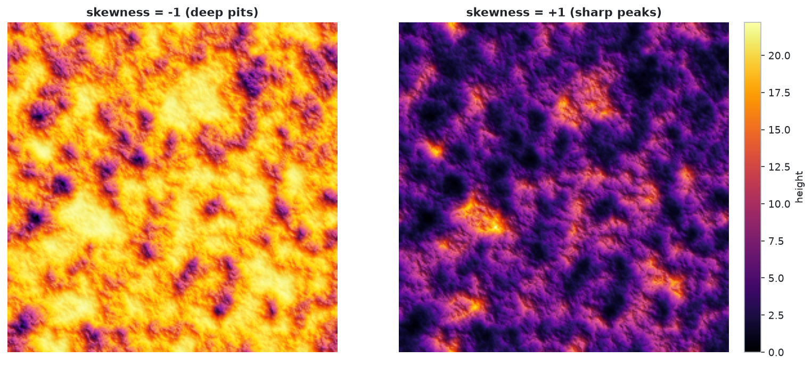

<p align="center">
  
</p>

**Generate rough 2D surfaces with a prescribed height distribution *and* spatial correlation.**

Real rough surfaces (corroded metal, fracture faces, AFM scans) are rarely Gaussian: a corroded plate has a few deep pits that a bell curve would never produce. This library lets you ask for exactly the numbers a surface scientist measures:

| Quantity | Meaning |
|---|---|
| **rms** | root-mean-square roughness: typical distance of heights from their mean |
| **skewness** | lopsidedness: positive = sharp peaks over a flat floor, negative = deep pits |
| **kurtosis** | tailedness: 3 is Gaussian; larger = rare extreme spikes, smaller = heights stay in a narrow range |
| **correlation length** ξx, ξy | distance beyond which two points on the surface are practically independent |
| **roughness exponent** α | how jagged the surface looks at small scales (α→0 jagged, α→1 smooth) |



**Documentation:** <https://blackpianocat.github.io/NonGaussianSurfaces/> (built from `mkdocs/` and published automatically with every PyPI release).

---

## Installation

```bash
pip install nongaussian-surfaces                  # core + static plots
pip install "nongaussian-surfaces[interactive]"   # + interactive Plotly figures
```

From a clone (development mode):

```bash
pip install -e ".[dev]"
```

Install name: `nongaussian-surfaces`; import name: `nongauss`.

## Quick start

```python
from nongauss import generate_surface, print_report, plots

res = generate_surface(N=256, rms=3, skewness=1, kurtosis=4,
                       corlength_x=12, corlength_y=12, alpha=0.8, seed=7)
print_report(res)                                    # requested vs. achieved statistics
res.z                                                # (256, 256) heights, min = 0

fig = plots.plot_heightmap_mask(res)                 # matplotlib figure
plots.save(fig, "surface.png")
plots.plot_heightmap_mask(res, interactive=True).show()   # Plotly version
```

Command line:

```bash
nongauss --skew 1 --kurt 4 --alpha 0.8 --out out/                 # PNG figures
nongauss --skew 1 --kurt 4 --alpha 0.8 --out out/ --interactive   # HTML figures
```

## Plots: static or interactive, your choice

Every `plot_*` function takes `interactive=False` (matplotlib, at most 2 panels per figure, white background) or `interactive=True` (Plotly: rotate, zoom, hover). Save either with `plots.save(fig, "name.png")` or `plots.save(fig, "name.html")`.

| Function | What it shows |
|---|---|
| `plot_surfaces(res)` | Gaussian scaffold vs. final surface in 3D |
| `plot_heightmap_mask(res)` | hillshaded heightmap, binarized mask |
| `plot_distribution(res)` | histogram + fitted Johnson PDF, Q-Q plot |
| `plot_profile_bearing(res)` | height profile, Abbott-Firestone bearing-area curve |
| `plot_hhcf_report(res)` | height-height correlation, requested-vs-achieved table |
| `plot_spectrum(res)` | 2D power spectrum, radial spectrum with expected slope |
| `plot_feasibility(points)` | Johnson (skewness, kurtosis) plane: which family your request falls in |
| `plot_compare(a, b, labels)` | two heightmaps on a shared color scale |
| `interactive.explorer(param, values)` | slider over skewness, kurtosis, rms or alpha |

Or by name: `plots.plot(res, "spectrum", interactive=True)`.

Skewness changes the look of a surface: negative gives a bright plateau with deep pits, positive gives sharp peaks over a flat floor.



All plots, with more figures and interactive versions, are in the docs (`mkdocs/`): heightmaps, distributions, bearing-area curve, correlation, spectrum, Johnson feasibility map, parameter sliders.

Interactive demos (open in a browser): [3D surfaces](https://htmlpreview.github.io/?https://github.com/BlackPianoCat/NonGaussianSurfaces/blob/main/mkdocs/docs/assets/interactive/surfaces.html), [skewness slider](https://htmlpreview.github.io/?https://github.com/BlackPianoCat/NonGaussianSurfaces/blob/main/mkdocs/docs/assets/interactive/explorer_skewness.html), [feasibility map](https://htmlpreview.github.io/?https://github.com/BlackPianoCat/NonGaussianSurfaces/blob/main/mkdocs/docs/assets/interactive/feasibility.html).

### Statistics without plots

```python
from nongauss import moments, hhcf_1d, abbott_curve, radial_psd, report_text

mean, std, skew, kurt = moments(res.z)
g = hhcf_1d(res.z, axis=1)        # height-height correlation along x
pct, h = abbott_curve(res.z)      # bearing-area curve
k, psd = radial_psd(res.z)        # isotropic power spectrum
```

The original entry point still works: `SAimage_fft_2(N=500, rms=3, skewness=1, kurtosis=3, seed=42, plot_style='none')` returns the height array.

---

## API reference

`generate_surface(N=500, rms=3.0, skewness=1.0, kurtosis=3.0, corlength_x=10, corlength_y=10, alpha=0.9, non_Gauss=True, invert=False, clip_percentiles=None, seed=None)` returns a `SurfaceResult` (`z`, `z_gauss`, `coef`, `j_type`, `msg`, `requested`).

| Parameter | Description |
|---|---|
| `N` | grid size (N × N pixels) |
| `rms`, `skewness`, `kurtosis` | target height statistics (Pearson kurtosis, Gaussian = 3) |
| `corlength_x`, `corlength_y` | correlation lengths in pixels; x runs along columns, y along rows |
| `alpha` | roughness exponent |
| `non_Gauss` | `False` returns the plain Gaussian surface |
| `invert` | flip the sign before shifting to min = 0 (also flips the skewness) |
| `clip_percentiles` | optional `(low, high)` noise clip; bounds heights but biases kurtosis down |
| `seed` | random seed for reproducibility |

Every function is documented in the mkdocs site (`mkdocs/`).

## How it works

1. **Spatial scaffold.** A Gaussian surface with autocorrelation `R(tx, ty) = rms² · exp(−(√((tx/ξx)² + (ty/ξy)²))^(2α))` is made by filtering white noise with the square root of the FFT of `R` (Wiener-Khinchin theorem: the power spectrum is the Fourier transform of the autocorrelation).
2. **Height distribution.** A Johnson distribution (a standard normal variable pushed through `sinh`, logistic, exponential or linear maps, types SU, SB, SL, SN) is fitted to the requested moments. The family is dictated by (skewness, kurtosis); `res.j_type` reports it. A two-point `ST` case appears on the boundary kurtosis = 1 + skewness².
3. **Rank mapping.** The pixel with the *k*-th lowest scaffold height gets the *k*-th lowest Johnson sample. This keeps the scaffold's spatial pattern and imposes the exact height distribution. The result is shifted to min = 0.

Notes: the mean is not a parameter (rms, skewness and kurtosis are shift-invariant, so they remain comparable to the request). Rank mapping is not a rigorous joint model, so the final correlation function differs slightly from the scaffold's. Since v0.2 `corlength_x` acts along image columns (axis 1); before, it acted along axis 0.

## Repository layout

```
src/
├── nongauss/
│   ├── johnson.py       # moments -> Johnson parameters; scipy distributions & sampling
│   ├── surface.py       # generation (FFT + rank mapping), statistics, reports
│   ├── plots.py         # matplotlib figures (<=2 panels), `interactive=True` dispatch
│   ├── interactive.py   # Plotly counterparts + parameter explorer
│   └── cli.py           # `nongauss` command
├── examples/make_readme_figures.py
├── tests/               # pytest suite
└── run_tests.py         # run the tests from a clone
jupies/                  # example Jupyter notebook (quickstart.ipynb)
mkdocs/                  # documentation site: Home, Guide, API reference (+ figures)
workflows/               # CI: tests + PyPI/docs publishing (move to .github/workflows/)
```

## Development

```bash
pip install -e ".[dev]"
python src/run_tests.py                      # tests
python src/examples/make_readme_figures.py   # regenerate figures
mkdocs serve -f mkdocs/config.yml            # preview docs
```

**Releasing.** Bump `version` in `pyproject.toml`, create a GitHub release: `workflows/publish.yml` (placed in `.github/workflows/`) runs the tests, publishes to PyPI (configure a [trusted publisher](https://docs.pypi.org/trusted-publishers/) for this repo and the `pypi` environment once) and deploys the mkdocs site to GitHub Pages (enable Pages from the `gh-pages` branch once).

## References

- Yang, F., et al. *Statistical generation of 3D rough surfaces with arbitrary correlation*, CMES 103(4), 251-279 (2014).
- Persson, B.N.J. *Theory of rubber friction and contact mechanics*.
- Dave (2021). *Johnson Curve Toolbox*, MATLAB Central File Exchange.

## Credits

- Surface generation algorithm (MATLAB): Dr. Vasilis Constantoudis
- Johnson fitting: ported from the MATLAB Johnson Curve Toolbox by Dave (2021); Python translation by Max Pierini, [EpiData.it](https://epidata.it)
- Python package, extensions and maintenance: Sebastian Korsak
- Johnson-type dispatch fix, plotting suite and package restructuring: with Claude

## License

Apache 2.0, see `LICENSE`.
