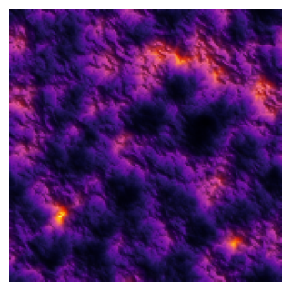
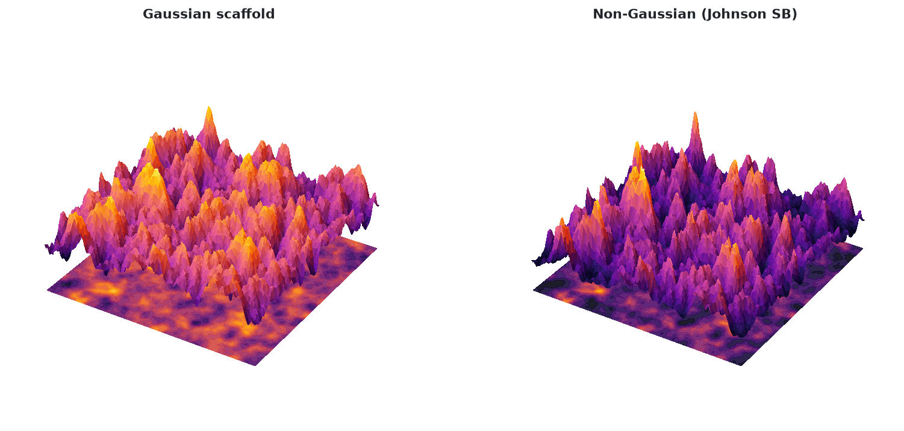
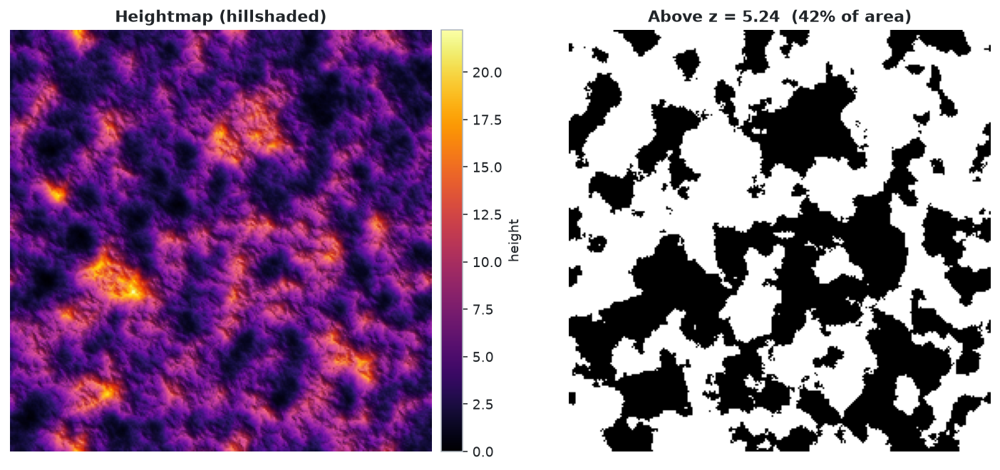

# nongaussian-surfaces

{ width=120 align=right }

Generate rough 2D surfaces, like the height maps measured with an AFM or a profilometer, with a **prescribed height distribution** and **spatial structure**. Real surfaces are rarely Gaussian: a corroded plate has a few deep pits that a bell curve would never produce, so you ask for the numbers you actually measure.

| Quantity | Meaning |
|---|---|
| **rms** | typical distance of heights from their mean |
| **skewness** | lopsidedness: positive = sharp peaks, negative = deep pits |
| **kurtosis** | tailedness: 3 is Gaussian, larger = rare tall spikes |
| **correlation lengths** \(\xi_x,\xi_y\) | distance beyond which two points are practically independent |
| **roughness exponent** \(\alpha\) | jaggedness at small scales (\(\alpha\to0\) jagged, \(\alpha\to1\) smooth) |



## Install

```bash
pip install nongaussian-surfaces                  # core + static plots
pip install "nongaussian-surfaces[interactive]"   # + interactive Plotly figures
```

## Quick start

```python
from nongauss import generate_surface, print_report, plots

res = generate_surface(N=256, rms=3, skewness=1, kurtosis=4,
                       corlength_x=12, corlength_y=12, alpha=0.8, seed=7)
print_report(res)                                   # requested vs. achieved statistics

res.z                                               # (256, 256) heights, min = 0
plots.plot_heightmap_mask(res)                      # static (matplotlib)
plots.plot_heightmap_mask(res, interactive=True)    # interactive (Plotly)
```



Go to the [Guide](usage.md) for every plot and how the method works, or the [API reference](api.md).

## Credits

Algorithm by Dr. Vasilis Constantoudis, after Yang et al., *CMES* 103(4), 251-279 (2014). Johnson fitting ported from the MATLAB *Johnson Curve Toolbox* by Dave (2021), Python translation by Max Pierini ([EpiData.it](https://epidata.it)). Package, extensions and maintenance by Sebastian Korsak, with Claude. Apache 2.0 license.
