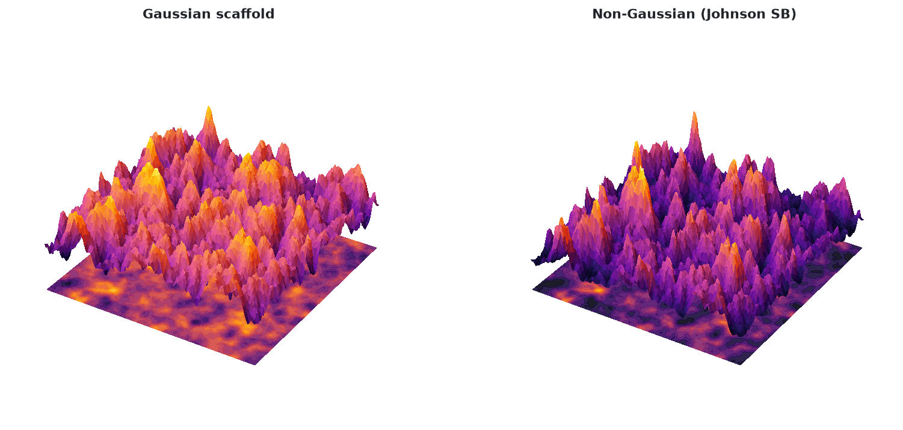
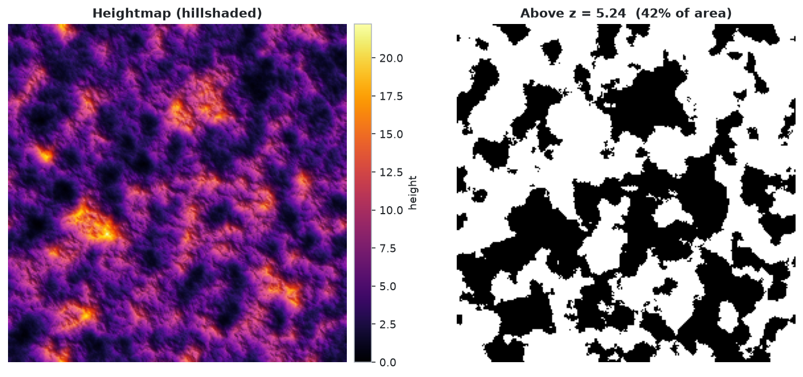
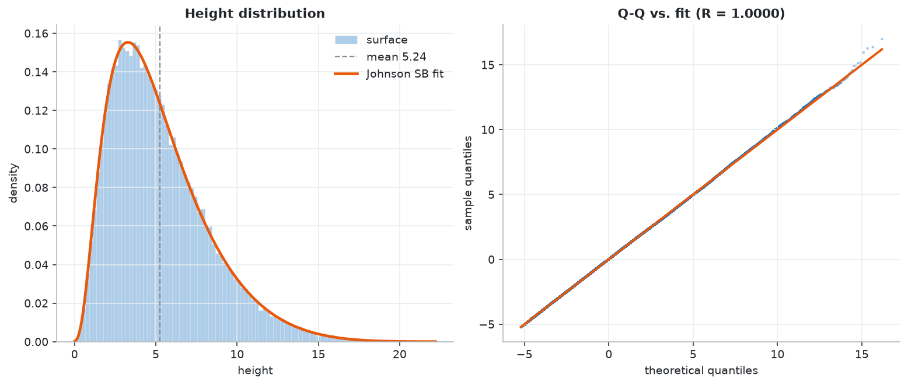
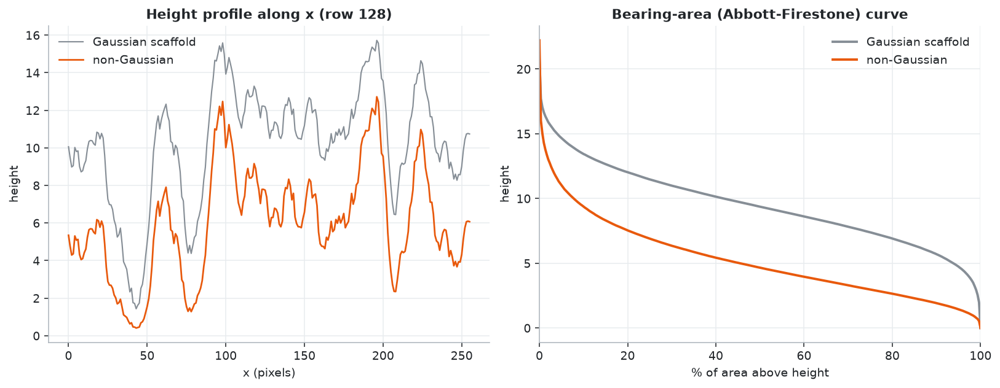
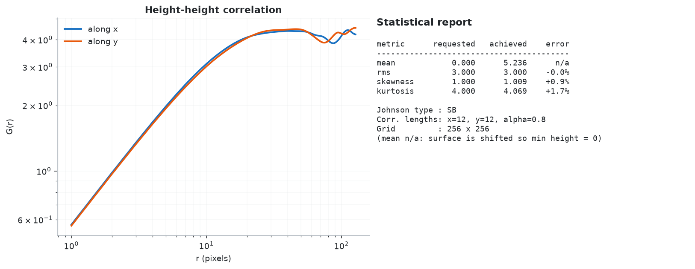
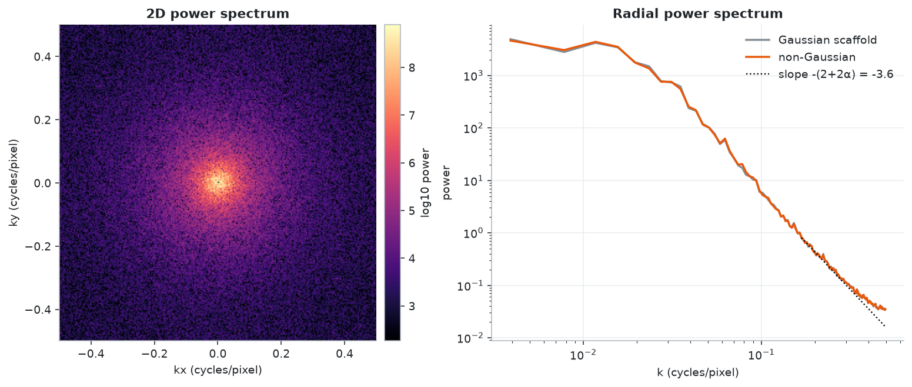
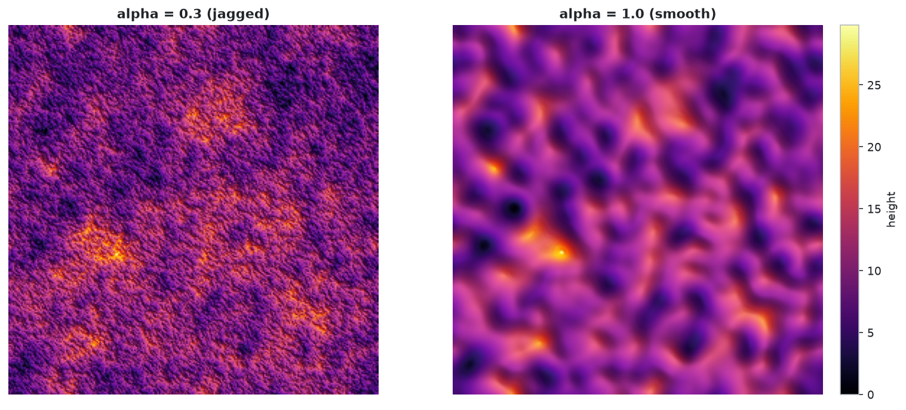
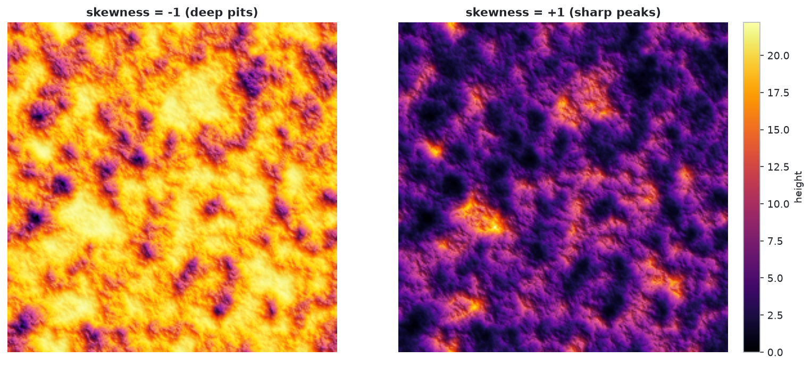
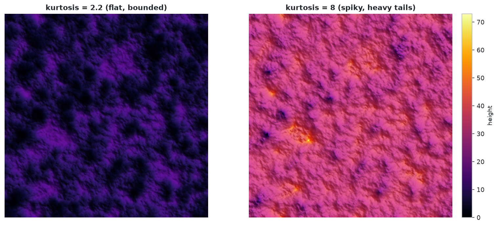
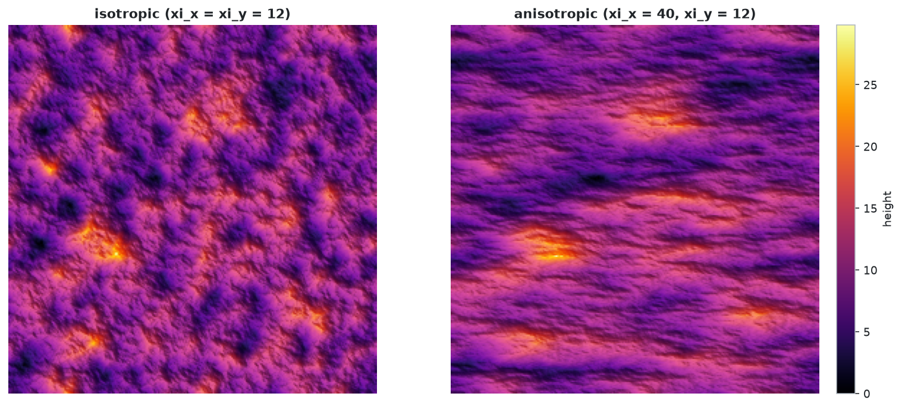

# Guide

## How it works

1. **Spatial scaffold.** A Gaussian surface with autocorrelation \(R=\text{rms}^2\exp[-(\sqrt{(t_x/\xi_x)^2+(t_y/\xi_y)^2})^{2\alpha}]\) is built by filtering white noise in Fourier space (the power spectrum, i.e. energy per spatial frequency, is the Fourier transform of \(R\)). It decides *where* hills and valleys are.
2. **Height distribution.** A Johnson distribution (a Gaussian variable pushed through a `sinh`, logistic, exponential or linear map; types SU, SB, SL, SN) is fitted to your (skewness, kurtosis). The family is dictated by those numbers, not chosen; kurtosis can never be below \(1+\text{skewness}^2\).
3. **Rank mapping.** The pixel with the *k*-th lowest scaffold height gets the *k*-th lowest Johnson sample, keeping the spatial pattern and imposing the exact height distribution. The surface is shifted to min = 0, so the mean is not a parameter.

## Plots: static or interactive

Every plot is available in two modes. Pass `interactive=False` (default) for a matplotlib figure with at most two panels, or `interactive=True` for a Plotly figure you can rotate, zoom and hover. Both return the figure object, so you can tweak it and call `plots.save(fig, "name.png")` or `plots.save(fig, "name.html")`.

```python
from nongauss import generate_surface, plots

res = generate_surface(N=256, rms=3, skewness=1, kurtosis=4, corlength_x=12, corlength_y=12, alpha=0.8, seed=7)
fig = plots.plot(res, "spectrum", interactive=True)   # or plots.plot_spectrum(res, interactive=True)
```

Available kinds: `surfaces`, `heightmap`, `distribution`, `profile`, `hhcf`, `spectrum`, `feasibility`.

## 3D surfaces

Hillshaded Gaussian scaffold next to the final surface, on the same height scale.



<iframe src="../assets/interactive/surfaces.html" width="100%" height="520" frameborder="0"></iframe>

## Heightmap and mask

Top-down hillshaded view and the binarized mask (area above a threshold, default the mean). Use `threshold=` to change it.



<iframe src="../assets/interactive/heightmap.html" width="100%" height="480" frameborder="0"></iframe>

## Height distribution

Histogram with the fitted Johnson PDF, and a Q-Q plot (observed vs. theoretical quantiles; a straight line means a perfect fit).



<iframe src="../assets/interactive/distribution.html" width="100%" height="480" frameborder="0"></iframe>

## Profile and bearing-area curve

The **Abbott-Firestone curve** shows what fraction of the surface lies above each height. It is a standard tool in tribology: it tells you how much material carries load as two surfaces approach.



<iframe src="../assets/interactive/profile.html" width="100%" height="480" frameborder="0"></iframe>

## Height-height correlation

\(G(r)=\sqrt{\langle (z(x+r)-z(x))^2\rangle}\) is how much heights differ at separation \(r\). It rises as a power law at small \(r\) (set by \(\alpha\)) and saturates near the correlation length. The table compares requested and achieved statistics.



<iframe src="../assets/interactive/hhcf.html" width="100%" height="480" frameborder="0"></iframe>

## Power spectrum

Left: 2D spectrum (energy per spatial frequency). Right: radial average with the expected \(k^{-(2+2\alpha)}\) slope.



<iframe src="../assets/interactive/spectrum.html" width="100%" height="480" frameborder="0"></iframe>

## Feasibility map

Check which Johnson family your (skewness, kurtosis) request falls in before generating.

```python
plots.plot_feasibility([(1, 4, "my request"), (0, 2.2, "flat")], interactive=True)
```

<iframe src="../assets/interactive/feasibility.html" width="100%" height="560" frameborder="0"></iframe>

## Effect of each parameter

`plots.plot_compare(res_a, res_b, ["label a", "label b"])` shows two heightmaps on a shared color scale.



`plots.plot_compare(res_a, res_b, ["label a", "label b"])` shows two heightmaps on a shared color scale.





## Parameter explorers

`interactive.explorer(param, values, **fixed)` adds a slider over `skewness`, `kurtosis`, `rms` or `alpha`; the seed is shared so only that parameter changes.

<iframe src="../assets/interactive/explorer_skewness.html" width="100%" height="560" frameborder="0"></iframe>
<iframe src="../assets/interactive/explorer_kurtosis.html" width="100%" height="560" frameborder="0"></iframe>

## Statistics without plots

```python
from nongauss import moments, hhcf_1d, abbott_curve, radial_psd, report_text

mean, std, skew, kurt = moments(res.z)
r_g = hhcf_1d(res.z, axis=1)         # along x
pct, h = abbott_curve(res.z)         # bearing-area curve
k, psd = radial_psd(res.z)           # isotropic power spectrum
```

## Command line

```bash
nongauss --skew 1 --kurt 4 --alpha 0.7 --out out/            # PNG figures
nongauss --skew 1 --kurt 4 --out out/ --interactive          # HTML figures
python -m nongauss --help
```

## Legacy entry point

```python
from nongauss import SAimage_fft_2
z = SAimage_fft_2(N=500, rms=3, skewness=1, kurtosis=3, seed=42, plot_style='none')
```

## Tests and docs

```bash
pip install -e ".[dev]"
python src/run_tests.py                      # test suite
python src/examples/make_readme_figures.py   # regenerate these figures
mkdocs serve -f mkdocs/config.yml            # preview this site
```
